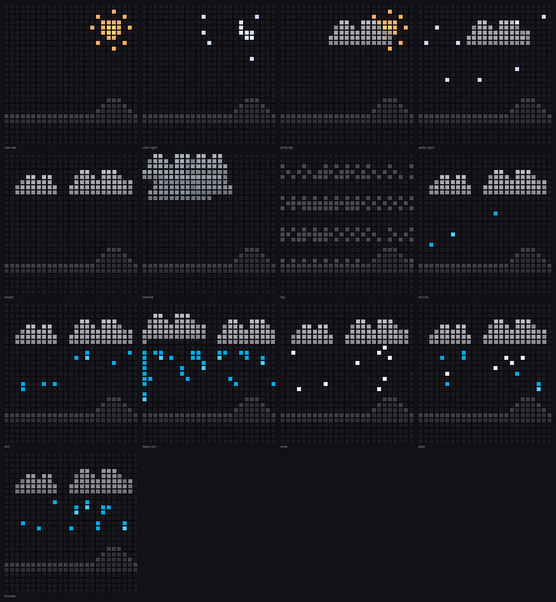
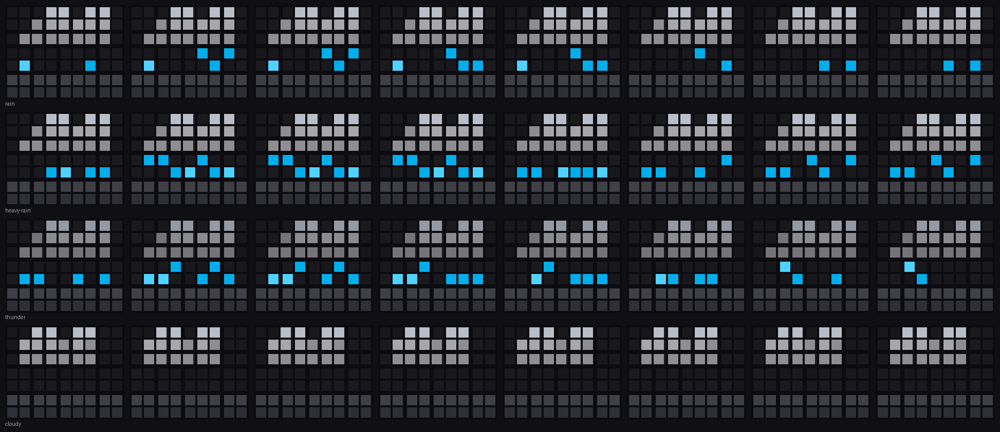

# Weather matrix widget

[](https://awesome-dsh-plugin.com)

A floating tile-mosaic weather card for the DSH Web UI: the left region is a
lattice of small square tiles where the weather is drawn by lighting tiles (gray
cloud tiles that flow across the lattice, cyan rain tiles, white snow tiles, an
amber sun), with the temperature in the bottom-left and the condition in the
bottom-right of that region. The right panel carries place + live clock, the
condition line, six 3-hourly slots and three range-bar days built from the same
tile language.

```sh
dsh plugin --profile web add github:ganglz1024/dsh-weather-matrix-widget
```

Requires DeepSeek Harness 0.2.x (`engines.dsh: ^0.2.0-rc.1`). After installing,
refresh the page; the widget appears in the top-right corner of the Web UI.

## Screenshots





The card lives in the frame-wide `shell.overlay` slot, so it floats above every
column like a desktop widget. It is draggable (position is remembered in
`localStorage`), a click refreshes it, it refreshes itself every minute and when
the page becomes visible again, and clicking the place name opens a city search
that can pin the widget to a fixed city.

## Scenes

The left region is a canvas lattice (~25x27 tiles at 236x248 CSS px): every cell
is a slightly-lighter dark tile on a darker gap, so the mosaic is always
visible. Weather lights tiles (cloud shades #a6a6ab / #8d8d92 / #b9bec8, rain
#00aeec, snow #eaf3ff, sun #ffd37a, moon #f2f0e2 with #ceccbd craters, fog #4a4a52). The two clouds
are hand-authored tile bitmaps with rounded stepped humps (big 12x5, small 8x4)
that keep a fixed silhouette while scrolling left→right across the lattice. A
cloud leaves through the right edge and re-enters on the left while fully
off-screen, so it is never drawn split in two; partly-cloudy nights keep only a
few dim stars. Overcast uses a darker layered cloud deck. Rain and snow spawn under the cloud's
own underside (never in empty sky), fall, and dissolve when they hit the ground
— the dim gray band at ~76% height with a small hill on the right. The current
temperature sits small in the bottom-left below the ground band, the condition
label in the bottom-right. The right-hand panel uses the same 10x9 pixel
language: each weather glyph is drawn as rounded squares with visible gaps
(13 kinds including the night variants), so the icons never blur into a blob.

| kind | scene |
|---|---|
| `clear` | amber tile sun with rays (day) or a warm round moon with craters + twinkling star tiles (night) |
| `partly` | one flowing cloud with the sun/moon peeking out |
| `cloudy` | two flowing clouds (small left, bigger right) |
| `overcast` | dense full-width bank |
| `fog` | drifting dithered tile bands |
| `drizzle` | cloud + a few short cyan tiles |
| `rain` | cloud + distributed cyan tiles |
| `heavy-rain` | denser, faster cyan tiles |
| `snow` | cloud + slow white tiles |
| `sleet` | cyan tiles + white tiles |
| `thunder` | darker cloud + rain + a tile lightning bolt during flashes |

`prefers-reduced-motion` renders a single static frame instead of animating.
Latin text and digits use the bundled Nunito variable font (SIL OFL 1.1, see
`LICENSE-Nunito.txt`); CJK text falls back to the rounded system font YouYuan
(幼圆).

## Install

Published as the GitHub package `ganglz1024/dsh-weather-matrix-widget`:

```sh
dsh plugin --profile web add github:ganglz1024/dsh-weather-matrix-widget
```

For local development, install the folder as a linked bundle:

```powershell
plugin_manager install_bundle target=E:\DeepSeekProjects\11-5\weather-matrix-widget
```

Disable/remove it from Settings → Plugins (row: 天气矩阵 / Weather matrix). The
plugin row comes from `cordis.patch.yml`; no other profile file is edited by the
plugin.

## Data path

```
browser  --GET /dsh-weather/api-->      Host half (index.js)
                                        ipwho.is -> city/lat/lon (24h memory cache)
                                        Open-Meteo -> current + hourly + 3-day (10min cache)
browser  --GET /dsh-weather/search?q--> Open-Meteo geocoding (30min cache)
         <-- JSON payload ------------- { ok, place, now, hourly[6], daily[3], fetchedAt, stale }
```

* `/dsh-weather/api` accepts `lat,lon,name,tz` to override the IP location; the
  widget passes the pinned city that way. `?force=1` bypasses the 10-minute
  cache.
* `/dsh-weather/search` returns up to 6 geocoding hits
  (`{name, admin1, country, latitude, longitude, timezone}`).
* No API key, no disk persistence. The pinned city and the last good payload
  live in the browser (`localStorage`); a failed refresh shows the cached data
  with a "网络不稳定" badge. Hourly entries carry `isDay` so the icons use the
  night variants.

## Files

| Path | Role |
|---|---|
| `index.js` | Host half: `inject = ['webServer']`, registers `GET /dsh-weather/api` and `GET /dsh-weather/search`, geo/forecast/search caches, never throws. `_internal` exposes the pipeline for tests. |
| `parts/05-font.js` | Generated: bundled Nunito variable font as a base64 `@font-face` rule (`WX_FONT_CSS`). |
| `parts/00-data.js` | Browser data layer: fetch/cache, pinned place, city search, WMO table, `wxIconFor` (night variants), scene + label helpers, zh/en dictionaries. |
| `parts/10-matrix.js` | Tile-mosaic scene engine: `createMatrixScene(canvas) -> { setScene, start, stop, dispose, setReducedMotion }`. |
| `parts/20-icons.js` | 10x9 pixel weather glyphs rendered as rounded squares with gaps (13 kinds incl. night). |
| `parts/30-view.js` | React card (layout, drag, city popover, hover hint, locale subscription, stylesheet). |
| `parts/90-register.js` | Client entry: locale dictionaries + `shell.overlay` registration. |
| `build.mjs` | Concatenates `parts/*.js` into the single browser artifact `client.js`. |
| `test/` | Host pipeline self-test, tile engine self-test + ASCII maps, manifest/artifact validation. |

The Web module loader consumes one file per package (`window.__ModuleLoader__.load`
factory), so `client.js` is generated — edit `parts/`, then rebuild:

```powershell
node build.mjs        # regenerates client.js
node --check client.js
```

## Sizing and minimizing

* The card scales uniformly between `0.8x` and `1.6x`. Presets (compact / default /
  large / extra large) live behind the `⤢` button that appears on hover, and the
  bottom-right grip drags a free size. Each size re-lays out the real CSS box and
  the scene canvas is re-rendered at its true size, so tiles stay crisp at every
  scale instead of being a stretched bitmap.
* `—` collapses the card into a small pill (about 292x62): a live 9x7 mini scene
  on the left (one compact cloud per weather, rain/snow visibly falling from it,
  a flat ground band, sun/moon fully in frame), a 24px temperature, place +
  condition, the live clock and a hover chevron. Click the pill to expand; drag
  it to move. The card is clamped inside the viewport on window resize.
* Size factor, minimized state and position persist in `localStorage`
  (`dsh-weather-matrix:ui:v1` and `:pos:v1`); double-click the grip resets to the
  default size.

## Tweaks

* Refresh cadence: `WX_REFRESH_MS` in `parts/00-data.js` (defaults to one minute;
  the view forces past the host-side 10-minute cache on each tick).
* Card geometry: `WX_CARD_W` / `WX_CARD_H` in `parts/30-view.js` are design
  pixels; every size in `WX_CSS` goes through `wxS(px)` == `calc(px *
  var(--wx-k))`, so the card scales as one unit. Size range + presets are
  `WX_MIN_K` / `WX_MAX_K` / `WX_SIZE_PRESETS`.
* Minimized pill: `WX_PILL_W` / `WX_PILL_H` and the `.wx-pill*` rules in
  `parts/30-view.js`; the mini scene grid is the `{ mini: true, cols: 9, rows: 7 }`
  option passed to `createMatrixScene` in the same file.
* Lattice density / tile colors: the geometry + palette constants in
  `parts/10-matrix.js`.
* Typography: the `font-family` stacks in the `WX_CSS` string of
  `parts/30-view.js`; the embedded Nunito font lives in `parts/05-font.js`
  (regenerate it from `fonts/nunito-latin.woff2` if needed).
* Icon palette: `WX_ICON_COLORS` in `parts/20-icons.js`.
* Scene palette: the `mx*` color tables in `parts/10-matrix.js`.
* Extra language: add an entry to `wxLocaleDicts()` and `WX_LOCALE_IDS`.

## Verify

```powershell
node test/host-selftest.mjs        # live network pipeline + city search, ALL PASS
node test/matrix-selftest.mjs      # headless pixel-buffer test + ASCII summaries per scene
node test/validate-manifest.mjs    # manifest / patch / locale / icon / artifact
Invoke-WebRequest `http://127.0.0.1:56507/dsh-weather/api` -UseBasicParsing
Invoke-WebRequest "http://127.0.0.1:56507/dsh-weather/search?q=%E9%95%87%E6%B1%9F" -UseBasicParsing
```

## License

MIT — see [LICENSE](LICENSE). The bundled Nunito font is licensed under the SIL
Open Font License 1.1 — see [LICENSE-Nunito.txt](LICENSE-Nunito.txt).